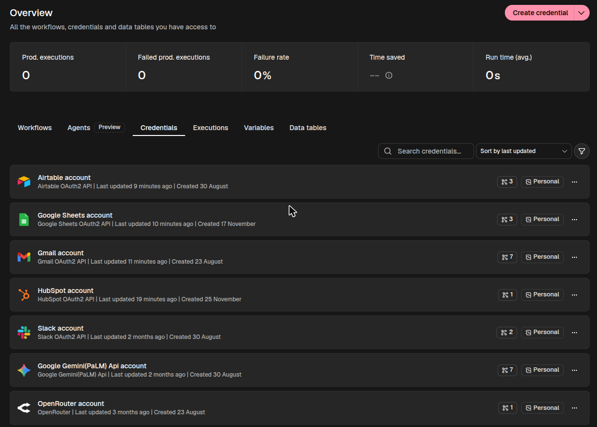
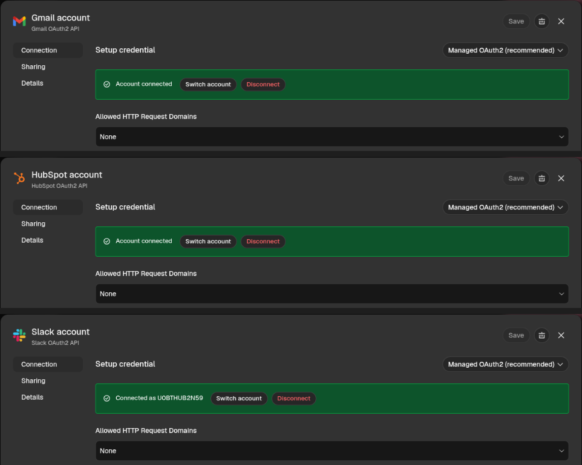
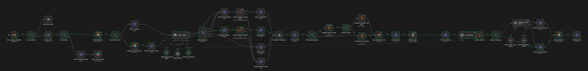
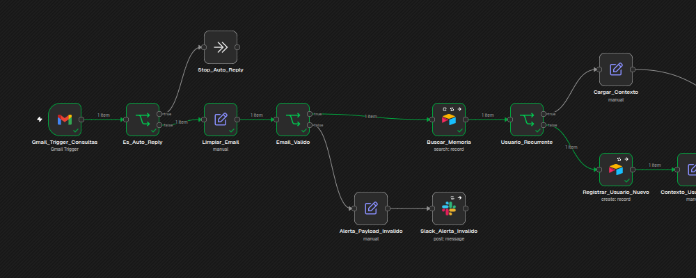
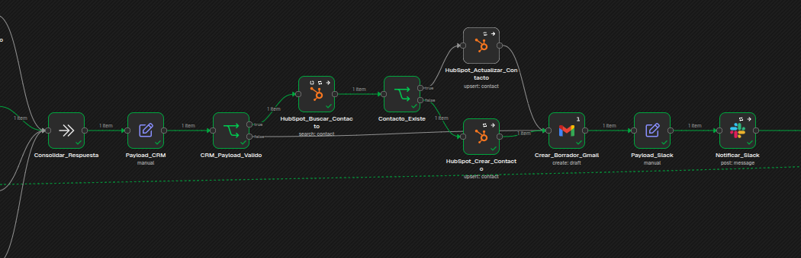
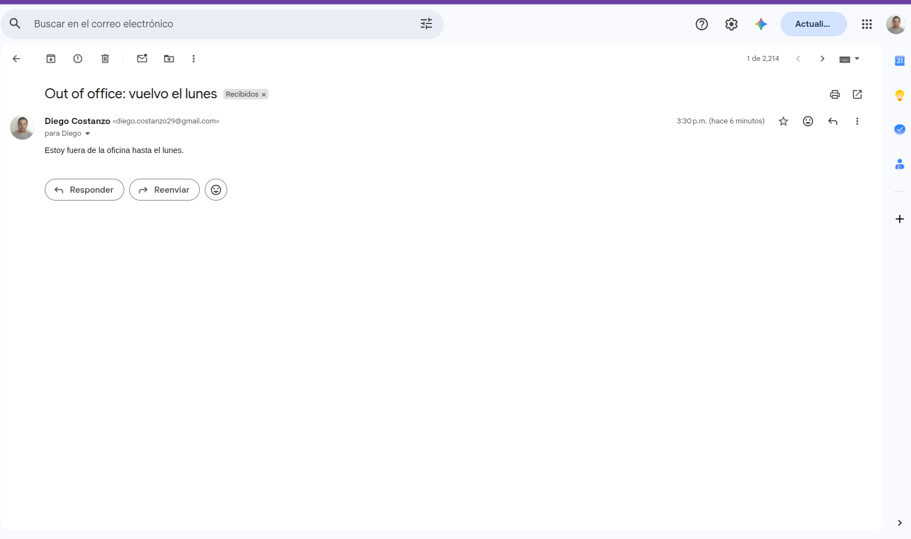
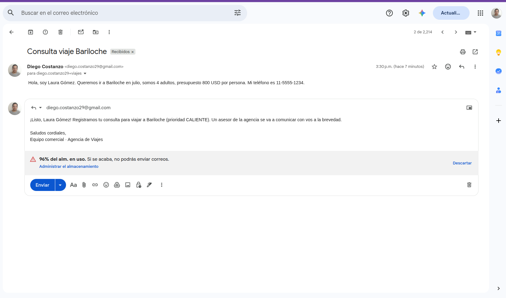
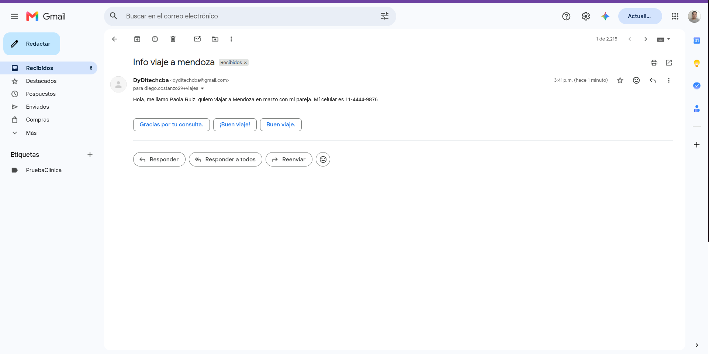
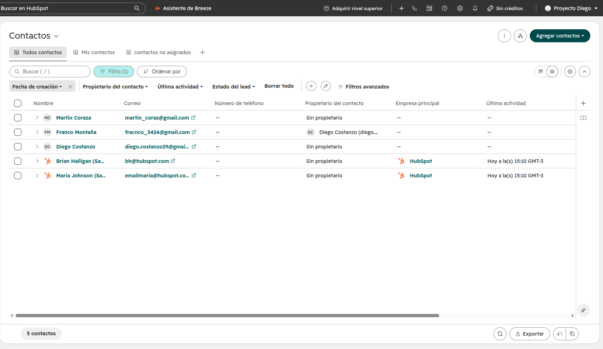
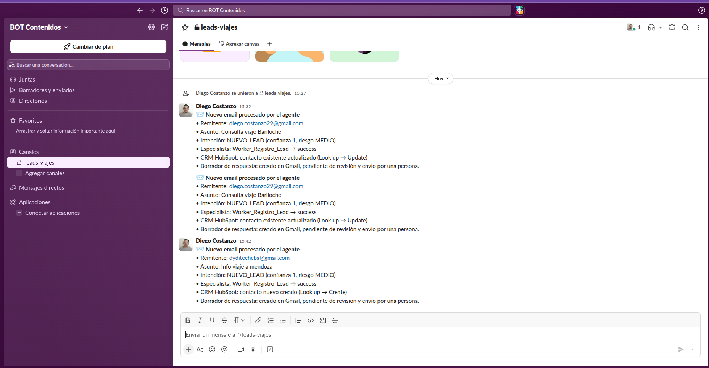

# M4 · Checkpoint de Integraciones Avanzadas e Interconexión de Sistemas

> **Pre-entrega 4 (Checkpoint 4)** · Módulo 4 del curso AI Automation (CoderHouse). Esta carpeta `m4/` contiene todo lo entregado: el workflow [`checkpoint4_diego_costanzo.json`](checkpoint4_diego_costanzo.json), este README y las capturas.

Evolución del Manager de M3 (memoria + contexto): el agente ahora **recibe las consultas por email**, **sincroniza el contacto en un CRM real** y **avisa al equipo por Slack**. Las tres herramientas externas están conectadas por **OAuth2**.

| Rol | Herramienta | Credencial n8n | Uso en el workflow |
|---|---|---|---|
| Casilla de correo | **Gmail** | Gmail OAuth2 API | Trigger de entrada + **Create Draft** |
| CRM | **HubSpot CRM** (cuenta gratuita) | HubSpot OAuth2 API | **Search** (look up) + Create / Update de contactos |
| Canal del equipo | **Slack** (canal `#leads-viajes`) | Slack OAuth2 API | Aviso de cada email procesado |

**Archivo de entrega:** [`checkpoint4_diego_costanzo.json`](checkpoint4_diego_costanzo.json) · workflow `M4 - Manager Agente Leads Viajes (Integraciones)`

## Credenciales (las 3 conexiones OAuth2 activas)





## Arquitectura

```
[Gmail_Trigger_Consultas]  (poll c/1 min · filtro to:<casilla>+viajes@gmail.com · solo no leídos · sin adjuntos)
        │
        ▼
① [Es_Auto_Reply (IF · OR · sin distinguir mayúsculas)] ── true ─▶ [Stop_Auto_Reply]  (corta el bucle infinito)
        │ false
        ▼
④ [Limpiar_Email (Set)]  From · Nombre_Remitente · Subject · BodyText (sin citas ni historial) · Thread_ID
        │                 Session_ID = email del remitente
        ▼
   [Email_Valido (IF: From con formato de email y cuerpo no vacío)] ── false ─▶ [Alerta_Payload_Invalido (Set)] → [Slack]
        │ true
        ▼
   MEMORIA M3 (Airtable por Session_ID) → [Router_Triage (Gemini · taxonomía cerrada)] → [Switch_Intencion]
   → Workers M2 (Registro / Escalamiento) → [Consolidar_Respuesta]
        │
        ▼
④ [Payload_CRM (Set)]  email · firstname · lastname · phone · intent · nota_crm
        │
        ▼
   [CRM_Payload_Valido (IF: email válido y no FUERA_DE_ALCANCE)] ── false ──────────────────────┐
        │ true                                                                                  │
        ▼                                                                                       │
② [HubSpot_Buscar_Contacto (Search · email EQ · límite 1)] → [Contacto_Existe (IF)]            │
        ├─ true  → [HubSpot_Actualizar_Contacto]  (solo nota + Lead Status IN_PROGRESS)         │
        └─ false → [HubSpot_Crear_Contacto]       (nombre, apellido, teléfono, nota, lifecycle) │
        │                                                                                       │
        ▼                                                                                       ▼
③ [Crear_Borrador_Gmail (Draft · mismo hilo · para el remitente)]  ◀───────────────────────────┘
        │
        ▼
   [Payload_Slack (Set: un solo campo "texto")] → [Notificar_Slack (#leads-viajes)]
        │
        ▼
   ESCRITURA DE MEMORIA M3 (resumen agéntico + upsert en Airtable) → [Resultado_Final]
```



## Los 4 controles que pide la rúbrica

| # | Nodo | Qué evita | Configuración |
|---|---|---|---|
| ① | `Es_Auto_Reply` (IF) inmediatamente después del trigger | **Bucle infinito** de auto-respuestas | Modo **OR**: asunto contiene `Auto-reply`, `Automatic reply`, `Out of office`, `Undeliverable`, `Delivery Status Notification`, `Respuesta automática`, `Fuera de la oficina`; remitente contiene `no-reply@`, `noreply@`, `mailer-daemon`; header `Auto-Submitted: auto-*`. Rama true → `Stop_Auto_Reply` (No Operation). |
| ② | `HubSpot_Buscar_Contacto` + `Contacto_Existe` antes del Create | **Error 409** (contacto duplicado) | Search por `email EQ`. Si existe → **Update**; si no → **Create**. |
| ③ | `Crear_Borrador_Gmail` | Envíos autónomos (**Human-in-the-loop**) | Operación **Create Draft**, en el mismo hilo (`threadId`) y dirigido al remitente. Ningún nodo envía emails: una persona revisa y hace clic en *Enviar*. |
| ④ | `Limpiar_Email`, `Payload_CRM` + `CRM_Payload_Valido`, `Payload_Slack` | **Error 400** (payload mal formado) y "pasillo de la muerte" | Cada Set deja solo los campos que usa el nodo siguiente (el email crudo trae HTML, headers y metadatos). Los IF validan que el email tenga formato correcto y que haya contenido antes de llamar al agente o al CRM. A Slack llega un único campo de texto. |

No se filtra `RE:` en el asunto: la respuesta de un cliente a nuestro borrador es una consulta legítima y el agente debe procesarla con su memoria.





## Mínimo privilegio

| Herramienta | Lectura (pasado) | Escritura (futuro) | Qué NO hace |
|---|---|---|---|
| Gmail | Solo los emails dirigidos al alias `+viajes` y no leídos; sin descargar adjuntos | Solo **borradores** | No envía, no borra, no etiqueta, no lee el resto de la casilla |
| HubSpot | Search de **un** contacto por email, pidiendo 5 propiedades (`email`, `firstname`, `lastname`, `phone`, `lifecyclestage`) | Solo objetos **contacto**. Update toca únicamente `message` y `hs_lead_status`, así no pisa datos que cargó un vendedor. Create carga nombre, apellido, teléfono, nota y etapa `lead` | No toca deals, tickets, empresas ni borra registros |
| Slack | — | Un mensaje en **un** canal (`#leads-viajes`) | No lee mensajes ni escribe en otros canales |

Las credenciales son **Managed OAuth2** de n8n Cloud: el token no se ve ni se exporta en el JSON (solo su nombre e ID).

**Fuente única de verdad:** HubSpot es el dueño del dato del contacto; Airtable guarda la memoria de la conversación y la planilla de M2 sigue como registro operativo del Worker.

**Resiliencia:** los nodos de HubSpot y Slack reintentan una vez ante falla (`Retry On Fail`, 3 s) y, si siguen fallando, el flujo continúa (`On Error: Continue`). El error queda informado en el mensaje de Slack y el borrador se crea igual.

## Pruebas de regresión (ejecución manual, 25/11/2026)

| Caso | Email de prueba | Resultado |
|---|---|---|
| Auto-reply | Asunto `Out of office: vuelvo el lunes` | `Gmail_Trigger` → `Es_Auto_Reply` (true) → `Stop_Auto_Reply`. No se invocó al agente ni se consumieron tokens. |
| Contacto existente (**Update**) · #149 | `Consulta viaje Bariloche`: *"Hola, soy Laura Gómez. Queremos ir a Bariloche en julio, somos 4 adultos…"* | Router `NUEVO_LEAD` (confianza 1) → Worker registra el lead → HubSpot Search lo encuentra → **Update** → borrador en el hilo → aviso en Slack. |
| Duplicado · #151 | El mismo email, segunda ejecución | El Worker detecta el duplicado ("Ya tenemos tu consulta registrada…"); HubSpot vuelve a Update (no crea otro contacto); memoria guardada en Airtable. 32 nodos ejecutados, 0 errores. |
| Contacto nuevo (**Create**) · #153 | Desde otra casilla: `Info viaje a mendoza`: *"Hola, me llamo Paola Ruiz, quiero viajar a Mendoza en marzo con mi pareja…"* | HubSpot Search no lo encuentra → **Create** (contacto nuevo con nombre y teléfono) → borrador → Slack: *"contacto nuevo creado (Look up → Create)"*. |

| Evidencia | |
|---|---|
| Auto-reply ignorado |  |
| Borrador generado en el hilo (pendiente de *Enviar*) |  |
| Consulta desde otra casilla (caso Create) |  |
| Contactos en HubSpot |  |
| Avisos en Slack (Update ×2 y Create) |  |

## Cambios respecto de M3

- **Entrada:** el Chat Trigger se reemplaza por `Gmail_Trigger_Consultas`. `Limpiar_Email` expone `sessionId` y `chatInput`, así la lógica de memoria y orquestación de M3 queda igual.
- **Router:** el System Prompt suma una sección `# CANAL`: el mensaje llega por email, el remitente cuenta como contacto y la respuesta va a un borrador con formato de email.
- **Observabilidad:** el log por Gmail de M3 se reemplaza por Slack. Un email de log a la misma casilla vigilada podría volver a disparar el flujo (bucle).
- **Modelo:** se mantiene **Google Gemini**. El curso recomienda GPT-4o o Claude Sonnet, pero ninguno tiene nivel gratuito en su API; cambiarlo es reemplazar solo el nodo *Chat Model* conectado al Router.

## Cómo importarlo y probarlo

1. En n8n: *Import from File* → `checkpoint4_diego_costanzo.json`. También deben existir los Workers de M2 ([`../m2/`](../m2/)) y la base de Airtable de M3 ([`../m3/`](../m3/)).
2. Crear o seleccionar las credenciales: **Gmail OAuth2**, **HubSpot OAuth2**, **Slack OAuth2**, Airtable OAuth2 y Google Gemini.
3. En `Gmail_Trigger_Consultas` → *Filters* → *Search*, reemplazar `TU_USUARIO+viajes@gmail.com` por la casilla a vigilar.
4. En `Notificar_Slack` y `Slack_Alerta_Invalido`, elegir el canal del equipo.
5. Mandar un email a la casilla y hacer clic en **Execute workflow**: el trigger toma el último email no leído que cumpla el filtro.
